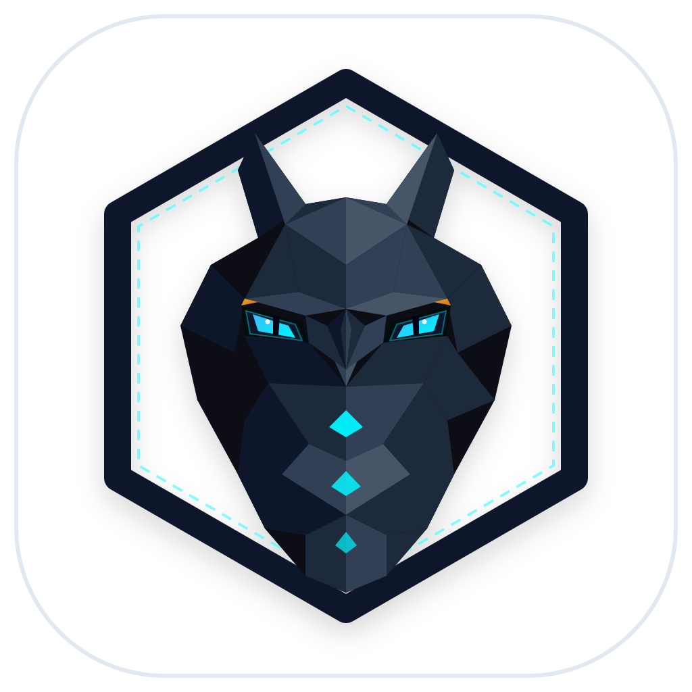
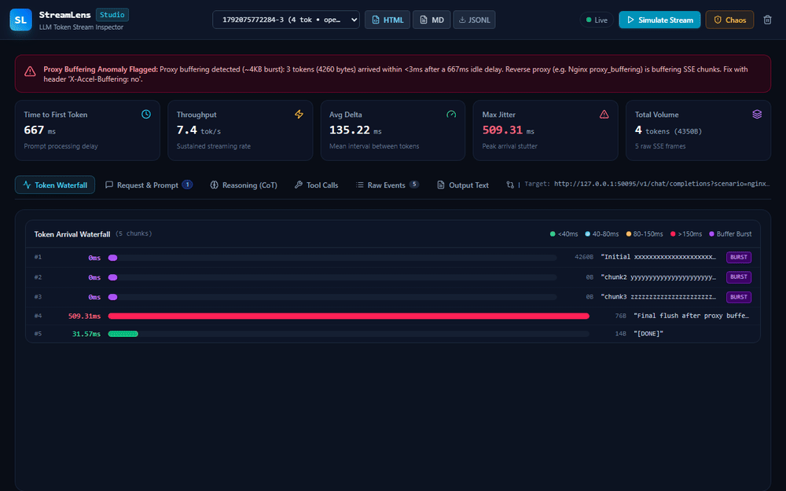

<div align="center">
  
  <h1>StreamLens</h1>
  <p><strong>Server-Sent Events (SSE) and LLM Token Stream Inspector with Real-Time Tool-Call JSON Reconstruction</strong></p>

  <p>
    <a href="#quickstart">Quickstart</a> •
    <a href="#core-features">Features</a> •
    <a href="#cli-reference">CLI Commands</a> •
    <a href="#web-studio">Web Studio</a> •
    <a href="#architecture">Architecture</a> •
    <a href="docs/PROXY_BUFFERING_GUIDE.md">Proxy Buffering Guide</a>
  </p>
</div>

---



---

## Overview

Modern AI applications stream responses via Server-Sent Events (`text/event-stream`). While streaming delivers quick feedback to users, intermediate reverse proxies (Nginx, Cloudflare, Traefik) and network hops often introduce subtle failures:

1. **Proxy Buffering Bottlenecks:** Reverse proxies buffer small TCP chunks until a 4KB memory threshold is reached, turning smooth token flows into jagged multi-token bursts.
2. **Broken Streaming Tool Calls:** LLMs stream function arguments as fragmented JSON substrings (`{"loc`, `ation": "London"}`). Standard JSON parsers throw syntax errors when inspecting in-flight arguments.
3. **Inter-Token Latency Jitter:** Server queue delays, prompt cache misses, and network stutters produce erratic token pauses that degrade user experience.

StreamLens is a lightweight, zero-dependency local reverse proxy and visual Web Studio designed to inspect, measure, and debug streaming LLM traffic.

Point your application base URL to `http://localhost:50085/v1` and StreamLens transparently proxies requests to OpenAI, Anthropic, or local Ollama servers while providing live diagnostics.

---

## Core Features

* **Zero-Latency Reverse Proxy:** Transparently forwards requests to OpenAI, Anthropic, or local Ollama instances while preserving headers, credentials, and streaming flags.
* **Microsecond Arrival Timing:** Captures exact arrival timestamps with microsecond precision, measuring Time to First Token (TTFT), sustained tokens per second (TPS), and inter-token jitter.
* **Proxy Buffering Anomaly Detection:** Heuristic engine detects when reverse proxies (such as Nginx default 4KB buffers) hold back tokens and flush them in near-zero millisecond bursts.
* **Streaming Tool-Call JSON Assembler:** Stateful parser reconstructs partial function call JSON on every chunk, producing valid AST structures before the stream finishes and flagging syntax errors.
* **Deterministic Chaos Simulation:** Injects synthetic proxy buffering (e.g., 4096-byte buffers), artificial jitter (50 to 200ms delays), and mid-stream disconnects to verify client resilience.
* **Embedded React 19 Web Studio:** Built-in interactive dashboard showing token waterfalls, raw SSE packet logs, reconstructed JSON objects, and live chaos toggles.
* **Deterministic Mock Server:** Built-in LLM stream simulator (`streamlens mock`) with 5 realistic streaming profiles for offline testing without API keys.
* **Session Recording and Replay:** Save sessions to `.jsonl` files and replay them at original or altered speeds to reproduce production bugs locally.

---

## Quickstart

### 1. Installation

Clone and install dependencies:

```bash
git clone https://github.com/alexandrmotologa/streamlens.git
cd streamlens
npm install
npm run build
```

Run directly with Node or npx:

```bash
node bin/streamlens.js proxy
```

### 2. Point Your Application to the Proxy

Update your OpenAI or Anthropic client base URL:

```typescript
import OpenAI from 'openai';

const openai = new OpenAI({
  apiKey: process.env.OPENAI_API_KEY,
  baseURL: 'http://localhost:50085/v1' // Route through StreamLens
});

const stream = await openai.chat.completions.create({
  model: 'gpt-4o',
  messages: [{ role: 'user', content: 'Explain Server-Sent Events.' }],
  stream: true
});

for await (const chunk of stream) {
  process.stdout.write(chunk.choices[0]?.delta?.content || '');
}
```

Open the visual dashboard in your browser at `http://localhost:50085/_studio`.

---

## CLI Reference

### `streamlens proxy`

Starts the transparent reverse proxy and embedded Web Studio:

```bash
# Proxy to OpenAI (default target)
streamlens proxy --port 50085

# Proxy to Anthropic Messages API
streamlens proxy --port 50085 --target https://api.anthropic.com

# Proxy to local Ollama instance
streamlens proxy --port 50085 --target http://localhost:11434

# Enable synthetic Nginx 4KB proxy buffering
streamlens proxy --chaos-buffer 4096

# Inject 50-150ms token jitter and record to file
streamlens proxy --chaos-jitter-min 50 --chaos-jitter-max 150 --record stream.jsonl
```

### `streamlens mock`

Starts a local mock LLM server generating realistic SSE streams:

```bash
streamlens mock --port 50086 --scenario smooth
```

Available scenarios:
* `smooth`: Consistent 35ms inter-token spacing.
* `nginx-buffered`: Simulates 4KB proxy buffering with long pauses followed by instant bursts.
* `jitter`: Erratic arrival times with spikes up to 420ms.
* `tool-call`: Streams partial JSON arguments across 8 chunk deltas.
* `interrupted`: Terminates the TCP stream unexpectedly midway through generation.

### `streamlens replay`

Replays a recorded `.jsonl` stream over a local SSE endpoint:

```bash
streamlens replay stream.jsonl --port 50087 --speed 1.5
```

### `streamlens record`

Captures an active streaming endpoint to a JSONL file:

```bash
streamlens record "https://api.example.com/stream" --output captured.jsonl
```

---

## Web Studio

The embedded React 19 Studio provides four specialized inspector views:

1. **Token Arrival Waterfall:** Horizontal latency bars showing arrival timing for every token, highlighted by color (green for smooth <40ms, red for stutters >150ms, purple for coalesced bursts).
2. **Tool-Call Reconstructor:** Live view of partial JSON strings being reassembled chunk-by-chunk into structured objects, showing syntax completeness and JSON schema validity.
3. **Raw SSE Event Table:** Searchable log of raw event lines, bytes, timestamps, and payload previews.
4. **Chaos Controls:** Interactive sliders to adjust buffer thresholds, min/max jitter delays, and disconnect thresholds on the fly.

---

## Project Structure

```
streamlens/
├── bin/
│   └── streamlens.js               # CLI binary entrypoint
├── src/
│   ├── cli/
│   │   ├── commands/               # CLI subcommands (proxy, mock, replay, record, studio)
│   │   └── index.ts                # Commander program wiring
│   ├── core/
│   │   ├── sse/
│   │   │   ├── event-parser.ts     # SSE spec compliant parser with microsecond timer
│   │   │   ├── metrics-tracker.ts  # TTFT, TPS, jitter variance, and stats
│   │   │   └── buffer-detector.ts  # Flags reverse proxy packet coalescing
│   │   ├── tool-assembly/
│   │   │   ├── partial-json-parser.ts # Streaming partial JSON state machine
│   │   │   ├── json-reconstructor.ts  # OpenAI and Anthropic tool-call assembler
│   │   │   └── schema-checker.ts      # Validates assembled JSON schema
│   │   ├── proxy/
│   │   │   ├── forwarder.ts        # Transparent HTTP reverse proxy
│   │   │   ├── stream-tap.ts       # PassThrough tap inspecting SSE chunks
│   │   │   └── chaos-injector.ts   # Synthetic buffering and jitter engine
│   │   ├── mock/                   # Mock LLM streaming server and scenarios
│   │   └── replay/                 # Session recording replay engine
│   ├── server/
│   │   ├── api-router.ts           # REST API endpoints for Studio
│   │   ├── ws-hub.ts               # WebSocket real-time broadcast hub
│   │   └── local-server.ts         # Unified HTTP and WebSocket server
│   └── studio/                     # Embedded React 19 + Vite + Tailwind CSS Studio
├── tests/                          # Vitest unit and integration test suite
├── examples/                       # Sample test client and recorded traces
└── docs/                           # Technical documentation and guides
```

---

## Testing

Run the full test suite with Vitest:

```bash
npm test
```

StreamLens maintains test coverage across all core modules:
* SSE parser multiline handling and network chunk fragmentation.
* Partial JSON state machine repairing unclosed braces, quotes, and keys.
* Buffer anomaly detector flagging Nginx 4KB patterns.
* End-to-end proxy forwarder with live mock streams.

---

## License

MIT © Alexandr Motologa
